# Deploying to DreamHost over SSH

A complete walkthrough of publishing the site to
**catherinemonmarson.seailles.com**, with the screenshots from the first
successful deployment on 3 November 2026.

Follow it top to bottom the first time. Once SSH is set up, routine deployments
are only [§6](#6-build-the-site) to [§8](#8-extract-on-the-server) — about five
minutes.

> **Prefer Word?** `python scripts/make-deployment-doc.py` regenerates this as
> **Catherine-Monmarson-deployment-guide.docx** in the repository root, with the
> screenshots cropped to the relevant panel and embedded. Run
> `python scripts/make-crops.py` first if the crops are missing.

> **A note on the password.** The password is deliberately *not* written in this
> document, and it is blanked out in the screenshot at §4. This file lives in a
> git repository; a password that grants shell access and full write access to
> the live site does not belong there. Keep it in a password manager.

---

## Contents

1. [What you need](#1-what-you-need)
2. [Find your account details](#2-find-your-account-details)
3. [Enable SSH](#3-enable-ssh)
4. [Set the password](#4-set-the-password)
5. [Allow SSH through McAfee](#5-allow-ssh-through-mcafee)
6. [Build the site](#6-build-the-site)
7. [Upload the archive](#7-upload-the-archive)
8. [Extract on the server](#8-extract-on-the-server)
9. [Verify](#9-verify)
10. [Troubleshooting](#10-troubleshooting)
11. [Why not the File Manager](#11-why-not-the-file-manager)
12. [Making it one command](#12-making-it-one-command)

---

## 1. What you need

| | |
|---|---|
| A DreamHost account | with `seailles.com` hosted on it |
| Windows 10 or 11 | `ssh` and `scp` are built in — nothing to install |
| Node.js 22 or newer | only on the machine that builds the site |
| About 30 minutes | the first time; five minutes thereafter |

You never need FileZilla, WinSCP, or the panel's File Manager. See
[§11](#11-why-not-the-file-manager) for why the File Manager in particular
should be avoided.

---

## 2. Find your account details

Sign in at **panel.dreamhost.com**. The left sidebar is your map.

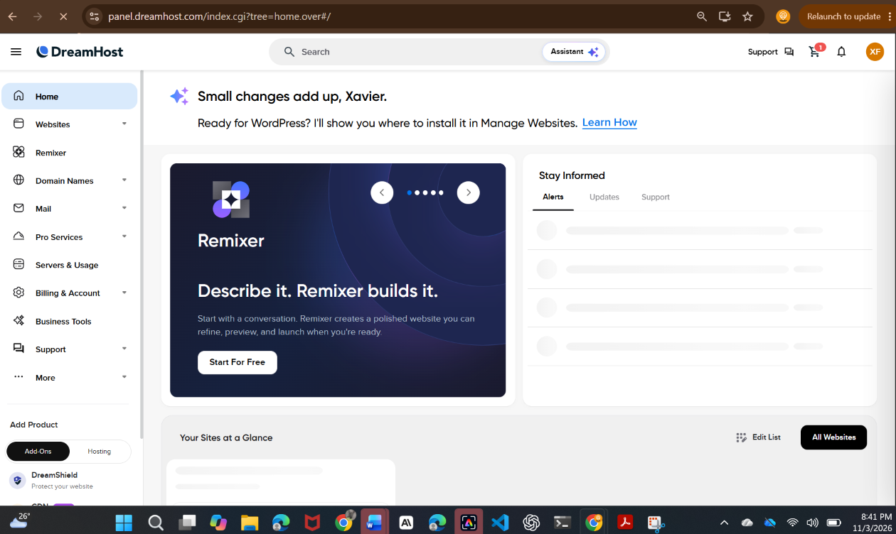

Open **Websites → Manage Websites**. This confirms which server the site is on
and which PHP version it runs — PHP matters later, when the contact form is
switched on.

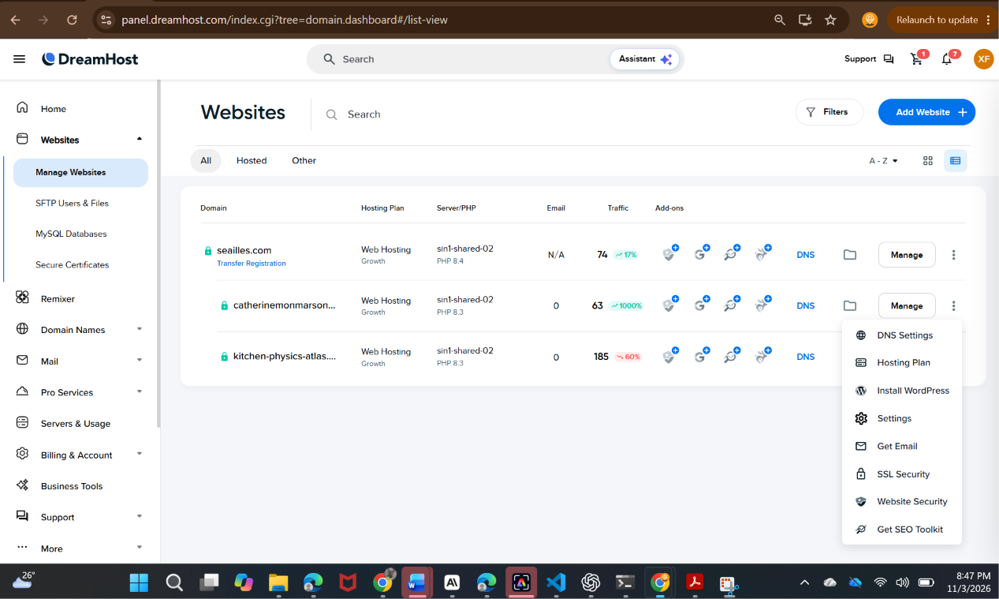

For this project:

| | |
|---|---|
| Domain | `catherinemonmarson.seailles.com` |
| Plan | Web Hosting Growth |
| Server | **`sin1-shared-02`** (Singapore) |
| PHP | 8.3 |
| Web server | Apache |

**Servers & Usage** shows the same server from the hardware side, and carries
the **Manage SSH Keys** link used in [§12](#12-making-it-one-command).

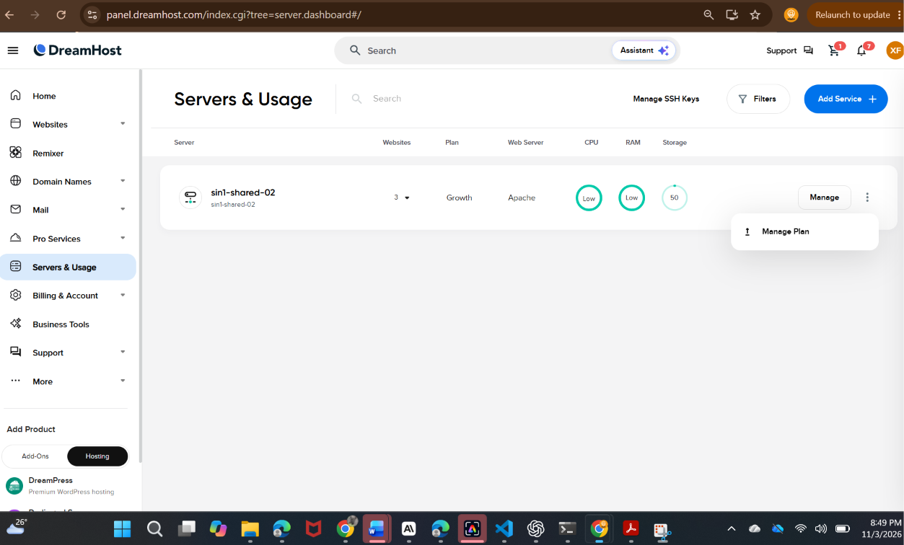

---

## 3. Enable SSH

Go to **Websites → SFTP Users & Files**. Each site has its own user.

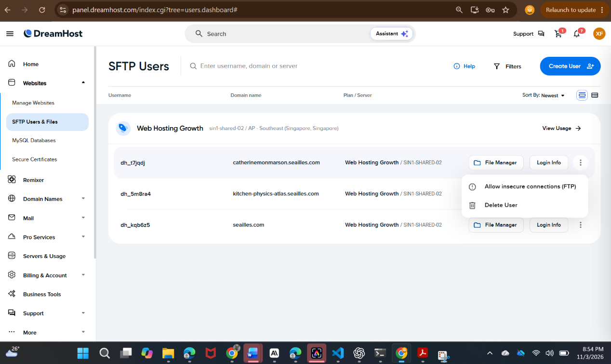

The user that owns this site is **`dh_t7jqdj`**. Note that the **⋮ menu on the
right is the wrong place** — it only offers "Allow insecure connections (FTP)"
and "Delete User". The SSH switch is elsewhere.

Click **Login Info** on that row. The panel expands to show the connection
details and a **Secure Shell Access (SSH)** toggle.

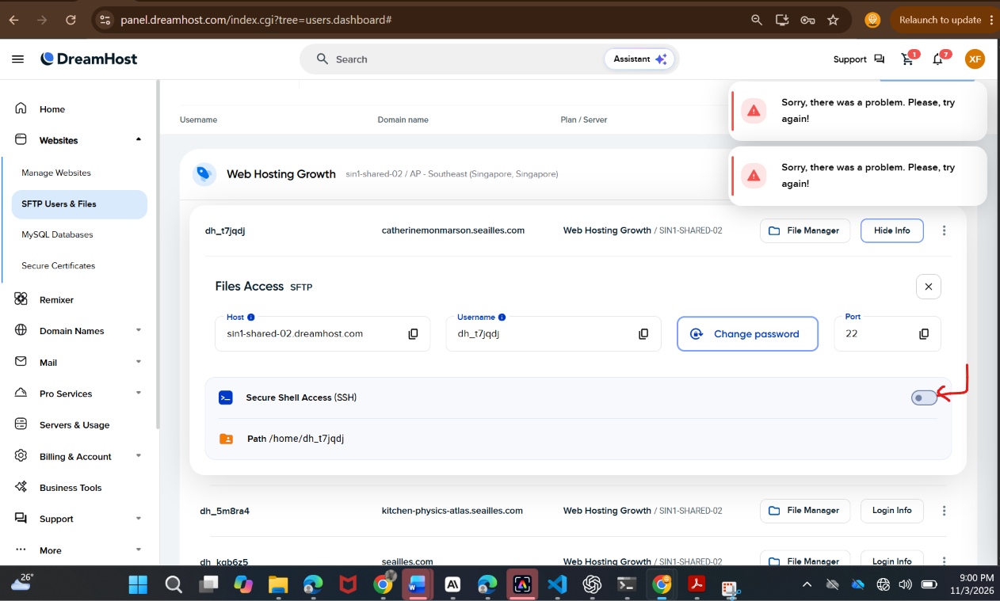

Record these — you will need all three:

```
Host      sin1-shared-02.dreamhost.com
Username  dh_t7jqdj
Port      22
Path      /home/dh_t7jqdj
```

Now flick the **Secure Shell Access (SSH)** toggle on the right.

> **If you see "Sorry, there was a problem. Please try again!"** — as in the
> screenshot above — the change has often been applied anyway. Reload the page
> before concluding it failed.

Watch the row. A progress bar reading **"Updating user permissions…"** means it
is working. This is the propagation step, and it is why trying to connect too
early fails.

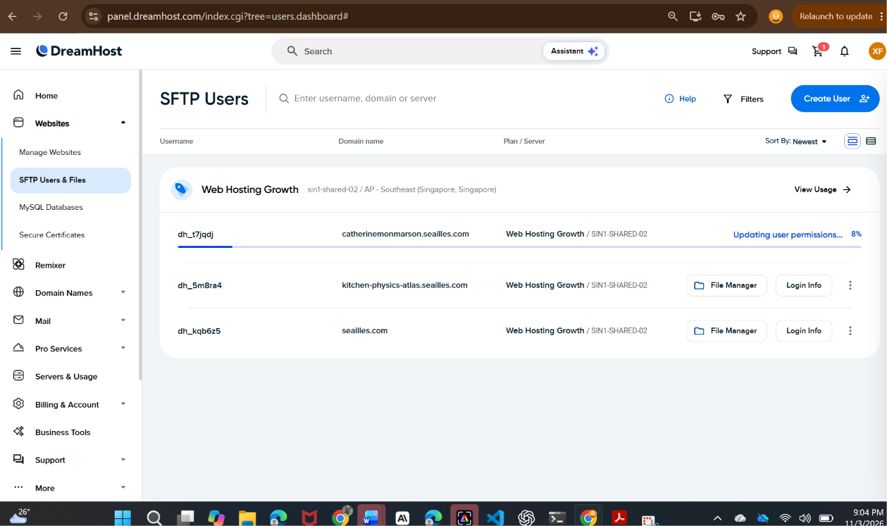

**Wait until the toggle turns blue** and a **Shell Type** dropdown appears
showing `/bin/bash`. That is the confirmation that SSH is live.

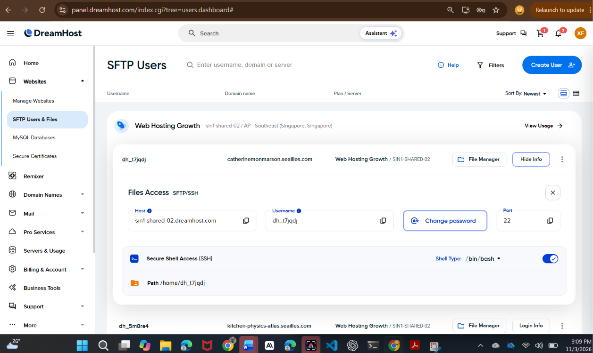

Allow about ten minutes from toggling to the server actually accepting logins.

---

## 4. Set the password

On the same expanded row, click **Change password**.

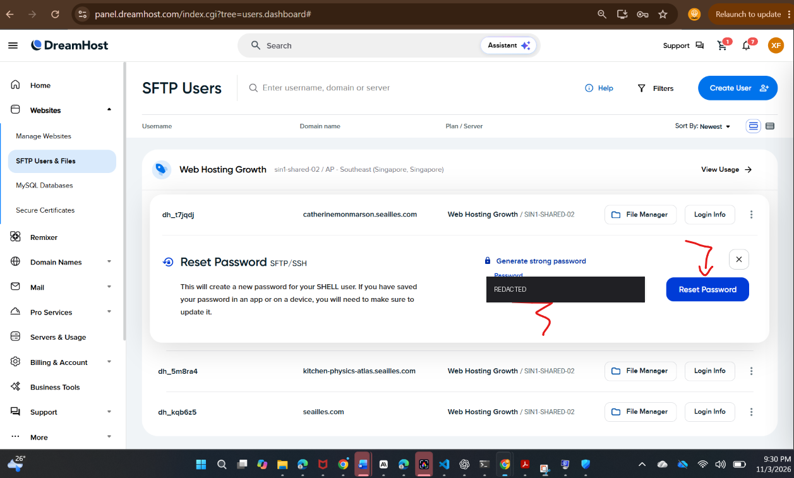

1. Click **Generate strong password**, or type one of your own
2. Click **Reset Password**
3. **Save it in your password manager immediately** — the panel will not show it again
4. **Wait ten minutes before using it**

That last point matters. A password change propagates to the server on the same
delay as the SSH toggle. Using it too soon gives
`Connection closed by … port 22` — which looks like a wrong password but is not.
See [§10](#10-troubleshooting).

The password field in the screenshot above is blanked because this document is
committed to git. If a password has ever appeared in a screenshot or a chat,
reset it.

---

## 5. Allow SSH through McAfee

On a machine running McAfee, SSH will fail before you are even asked for a
password. The symptom is distinctive: the connection is reset immediately, and
**it happens for every host, not just DreamHost.**

To confirm it is the firewall rather than DreamHost:

```powershell
ssh git@github.com
```

If that is also reset, the problem is local.

**The fix:** open McAfee → **Firewall** → the app-permissions list (often
*Internet Connections for Programs*) → grant full access to both:

```
C:\Windows\System32\OpenSSH\ssh.exe
C:\Windows\System32\OpenSSH\scp.exe
```

Turning the firewall off temporarily also works for a one-off deployment, but
the permission entries are worth adding — the same block breaks `git push` over
SSH and every other SSH tool.

---

## 6. Build the site

On the machine with the repository:

```powershell
cd C:\Users\Xavier\Documents\Github\catherine_monmarson
```
```powershell
npm run build
```

This generates `dist/` — around 1,850 files and 122 MB. It also writes
`.htaccess`, `robots.txt` and, when the contact form is enabled,
`contact.php`.

Then package it. **Use this script, not Windows' "Send to → Compressed
folder"**, and not PowerShell's `Compress-Archive`: both write ZIP entries with
backslashes, which Linux `unzip` treats as literal filenames, flattening the
site into one directory.

```powershell
python - <<'PY'
import zipfile, os
with zipfile.ZipFile(os.path.join('..','catherinemonmarson-site.zip'),'w',zipfile.ZIP_DEFLATED,compresslevel=6) as z:
    for dp,_,fs in os.walk('dist'):
        for f in fs:
            full = os.path.join(dp,f)
            z.write(full, os.path.relpath(full,'dist').replace(os.sep,'/'))
PY
```

That writes `C:\Users\Xavier\Documents\Github\catherinemonmarson-site.zip`,
with `index.html` at the top level of the archive — not inside a `dist/` folder.

---

## 7. Upload the archive

Open **Windows PowerShell** — your own window, not an editor's terminal, because
it must be able to prompt you for a password.

**Enter these as three separate lines.** PowerShell runs each line break
immediately, so a long line that wraps when pasted gets chopped into fragments:

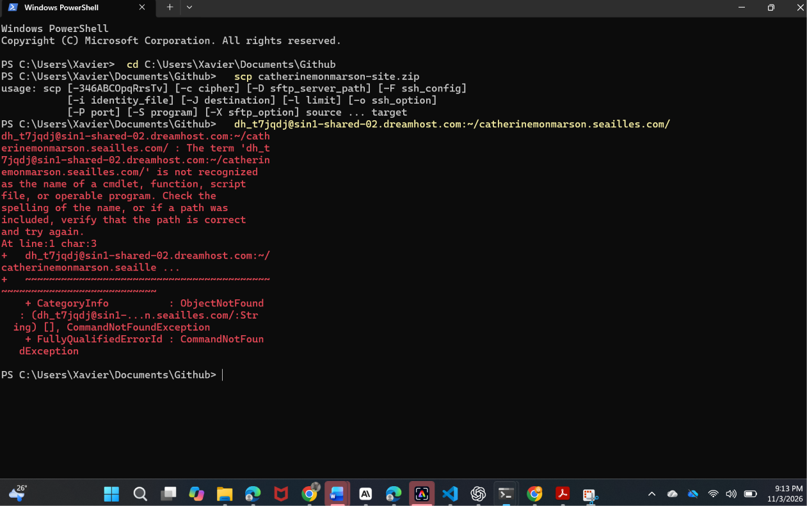

That error is a pasted command broken in two. Using a variable keeps every line
short enough that it cannot happen:

```powershell
cd C:\Users\Xavier\Documents\Github
```
```powershell
$dest = "dh_t7jqdj@sin1-shared-02.dreamhost.com:~/catherinemonmarson.seailles.com/"
```
```powershell
scp catherinemonmarson-site.zip $dest
```

The first connection asks about host authenticity — type `yes`. Then the
password. **Nothing appears as you type, not even dots.** That is normal.

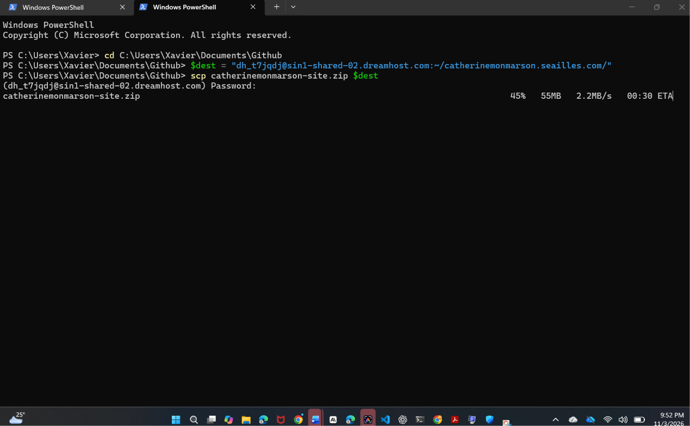

122 MB to Singapore takes roughly a minute at 2 MB/s. The percentage, transferred
size, rate and ETA update live.

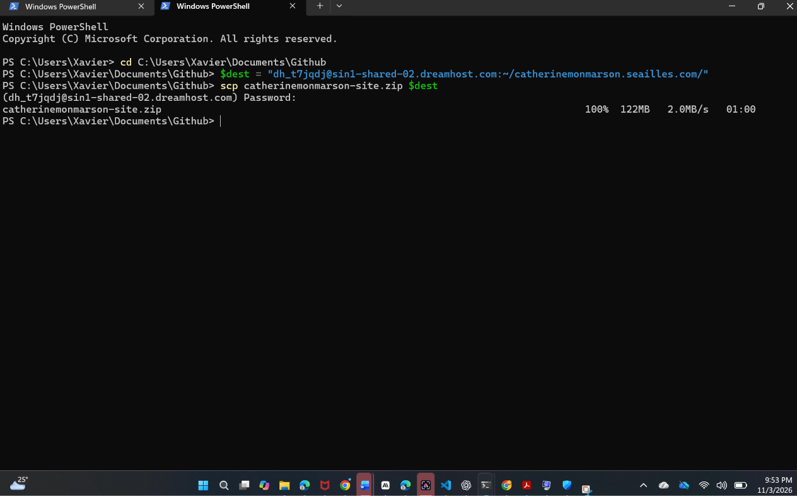

`100%  122MB  2.0MB/s  01:00` and a fresh prompt means the upload is done.

---

## 8. Extract on the server

```powershell
ssh dh_t7jqdj@sin1-shared-02.dreamhost.com
```

Password again. A DreamHost banner and a `[sin1-shared-02]$` prompt means you
are in.

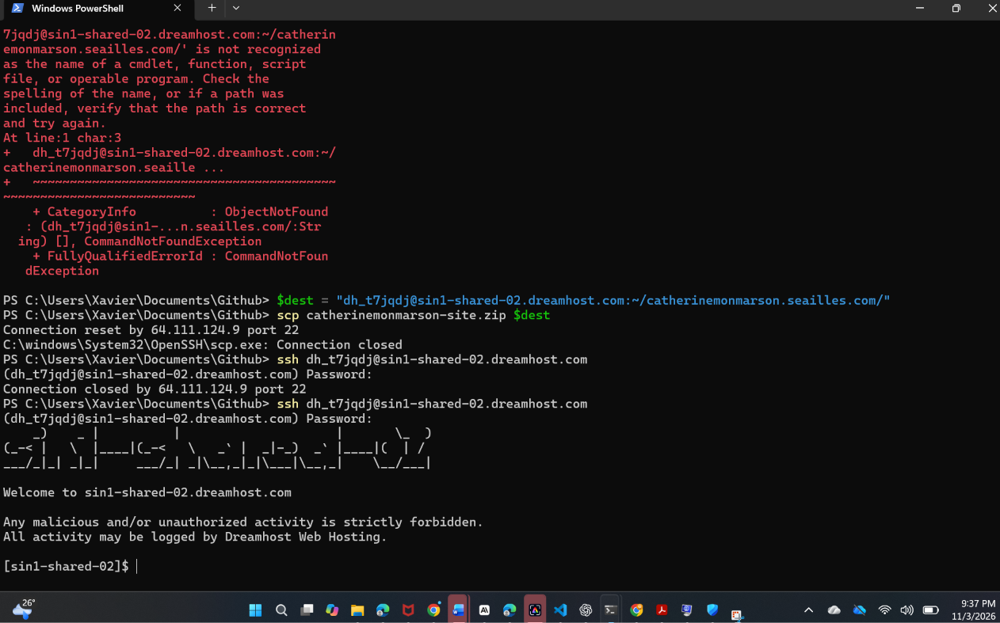

```bash
cd ~/catherinemonmarson.seailles.com
```
```bash
pwd
```

**Confirm it prints `/home/dh_t7jqdj/catherinemonmarson.seailles.com`** before
running anything destructive.

### Only when replacing the site wholesale

Skip this when you are simply updating — `unzip -o` overwrites in place. Run it
when the directory is in a bad state and you want a clean slate:

```bash
find . -maxdepth 1 -mindepth 1 ! -name '.dh-diag' -exec rm -rf {} +
```

The exclusion keeps `.dh-diag`, a DreamHost symlink. The `find` form is
deliberate: plain `rm -rf *` fails on thousands of filenames and silently skips
dotfiles such as `.htaccess` and `.well-known` — the latter is used for HTTPS
certificate renewal, so never delete it blindly.

### Extract

```bash
unzip -o catherinemonmarson-site.zip
```
```bash
rm catherinemonmarson-site.zip
```
```bash
ls -la
```

`-o` overwrites without prompting. About 1,850 lines scroll past. Deleting the
archive afterwards matters — it is 122 MB sitting in a public directory.

The listing should show **twelve entries plus the root files**:

```
.htaccess   _astro   atelier   contact   en   expedition
index.html  mentions-legales   merci   oeuvres   presse   series
404.html    robots.txt   favicon.svg   og-default.jpg
icon-192.png   icon-512.png   apple-touch-icon.png
site.webmanifest   sitemap-0.xml   sitemap-index.xml
```

`.htaccess` only appears with `ls -la`, not plain `ls`. If it is missing, the
custom 404, the security headers and the caching rules are all inactive.

Then `exit`.

---

## 9. Verify

Open **https://catherinemonmarson.seailles.com** — and use **Ctrl+Shift+R**.

A browser tab that saw the site while it was broken caches those failures, and
an ordinary reload will not clear them. If images look broken, try a private
window before suspecting the server.

Checks worth running from any terminal:

```bash
curl -s -o /dev/null -w "%{http_code}\n" https://catherinemonmarson.seailles.com/
curl -s https://catherinemonmarson.seailles.com/no-such-page | grep -c "Page introuvable"
curl -s -D- -o /dev/null https://catherinemonmarson.seailles.com/ | grep -i x-content-type
```

Expect `200`, then `1` (the custom French 404 proves `.htaccess` is active),
then the `nosniff` header.

A correct deployment serves all 358 pages in both languages, the stylesheet, the
images, the custom 404, four security headers and two cache policies.

---

## 10. Troubleshooting

### "Connection reset by … port 22", no password prompt

The key exchange is being killed. Test another host:

```powershell
ssh git@github.com
```

Also reset → local firewall, see [§5](#5-allow-ssh-through-mcafee).
Only DreamHost → the SSH toggle has not propagated; wait ten minutes.

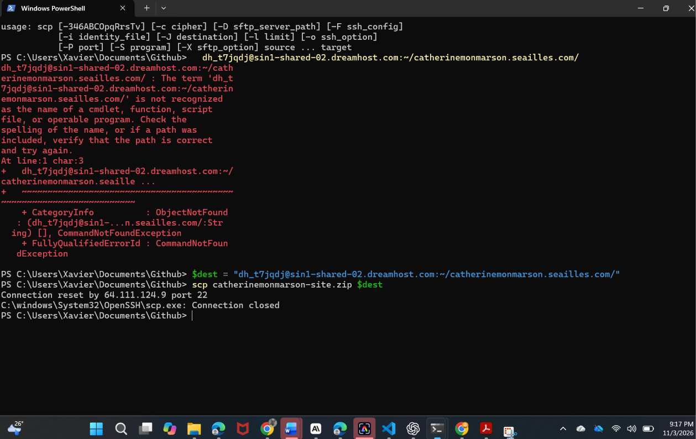

### "Connection closed by … port 22" *after* the password prompt

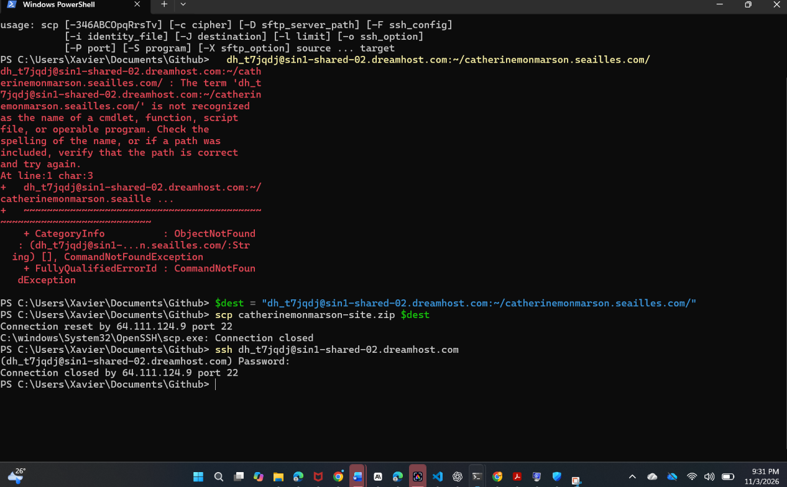

Reaching the prompt means SSH itself is working. This is almost always a
password change that has not propagated yet. Wait ten minutes and retry before
resetting it again.

### "The term '…' is not recognized as the name of a cmdlet"

A pasted command was split across lines. Use the `$dest` variable form in
[§7](#7-upload-the-archive).

### The site loads but has no styling

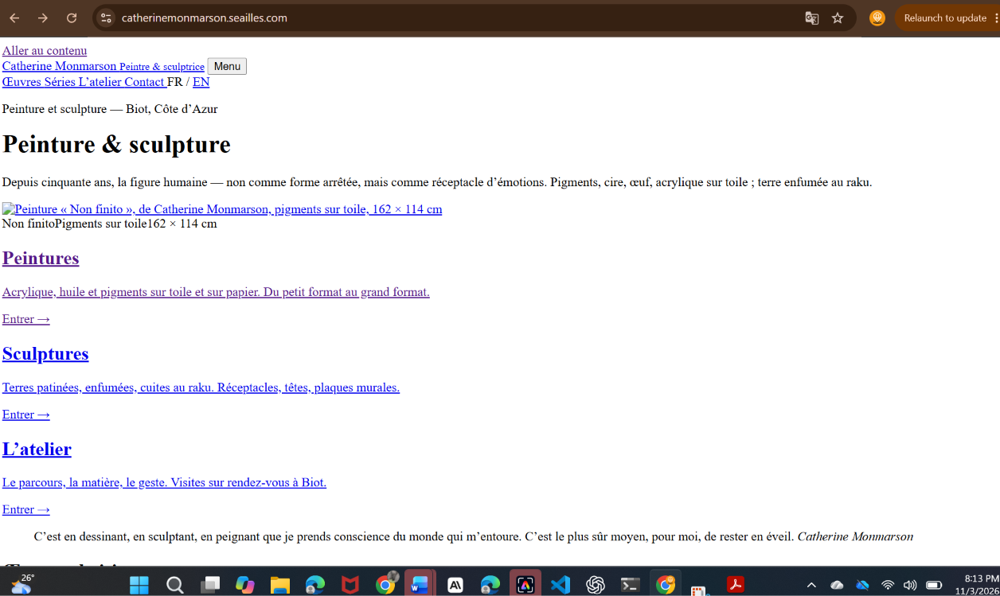

The HTML is being served but everything it references is 404ing. Either the
upload flattened the directories, or `_astro/` is missing. Check:

```bash
curl -s -o /dev/null -w "%{http_code}\n" https://catherinemonmarson.seailles.com/oeuvres/
```

`404` on a subdirectory while the homepage returns `200` is the signature.
Re-extract from the archive.

### "Permission denied (publickey,password)"

Wrong password, or the SFTP user's password rather than the panel login. Reset
it in the panel — [§4](#4-set-the-password) — and wait before using it.

### `unzip` flattens everything

The archive was built with backslash paths. Rebuild it with the Python script in
[§6](#6-build-the-site).

---

## 11. Why not the File Manager

The panel's web File Manager was tried first, and it produced this:

- all 1,638 files belonging in `_astro/` dumped loose in the web root
- all 358 pages saved as `index (1).html` … `index (356).html`, because the
  browser renames each duplicate download
- `.htaccess` renamed to `download`
- not one of the ten directories created

The site served unstyled HTML with broken images. Nothing was recoverable; the
directory had to be cleared and re-extracted.

Browser-based file managers are not built for two thousand files. One archive
extracted server-side is the only reliable route.

---

## 12. Making it one command

Once an SSH key is in place, no password is needed and deployment becomes a
single line.

Generate a key:

```powershell
ssh-keygen -t ed25519 -C "catherinemonmarson deploy"
```

Press Enter at each prompt. Then copy the **public** half:

```powershell
Get-Content ~\.ssh\id_ed25519.pub
```

In the panel, open **Servers & Usage → Manage SSH Keys** (visible in the
screenshot at [§2](#2-find-your-account-details)), add the key to `dh_t7jqdj`,
and wait the usual ten minutes.

After that:

```powershell
ssh dh_t7jqdj@sin1-shared-02.dreamhost.com
```

connects with no password, and deployment collapses to:

```powershell
npm run build
rsync -az --delete dist/ dh_t7jqdj@sin1-shared-02.dreamhost.com:~/catherinemonmarson.seailles.com/
```

`rsync` transfers only what changed — usually a few seconds rather than a
minute — and `--delete` removes files no longer in the build, which `unzip -o`
does not do.

---

## Moving to catherinemonmarson.com

When the real domain is ready, the site itself changes in one place:

1. Edit `data/to-confirm.json` → `site.url` → `https://catherinemonmarson.com`
2. `npm run build`
3. Add the domain under **Websites → Add Website**, enable **Let's Encrypt**
4. Upload and extract into the new domain's directory, as above
5. Keep the old subdomain for a few weeks with a redirect

Canonical links, `hreflang`, the sitemap, social card URLs, `robots.txt` and the
generated PHP all derive from that single value.
